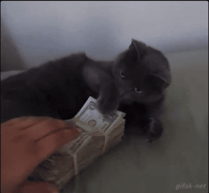

Someone reaches for the money. The cat answers.

This is a quick audit of a credit-risk table, about 32,000 loans, asking who defaults. It is a short pass, and it may keep going. Nothing here is a lending decision.

Duplicates came out. Missing employment length and interest rate were filled with the median. Home ownership, loan intent, and grade were encoded. Numbers were scaled. The split was 80/20, stratified so the default rate stayed honest. Logistic regression was the plain baseline. Random forest is the model worth keeping.

## Random forest

Held-out set: 6,484 loans. 5,066 were paid, 1,418 defaulted.

| | precision | recall | f1 |
|---|---:|---:|---:|
| paid (0) | 0.93 | 0.99 | 0.96 |
| default (1) | 0.97 | 0.72 | 0.83 |

Accuracy is 0.93. That looks calm because most loans are paid. A model that always says "no default" would already be right about 78% of the time.

The default row is the one that matters. The forest catches about 72% of defaults, roughly 1,020 of 1,418, and misses about 400. When it calls a default, it is right about 97% of the time. Macro F1 is 0.89. Logistic regression only caught 57% of defaults, with a macro F1 of 0.79.

Both numbers use the default 0.5 cutoff. The next small tweak, if this continues, is that threshold. Lower it and more defaults get caught, with more false alarms. That is the change that matches what a missed default actually costs.